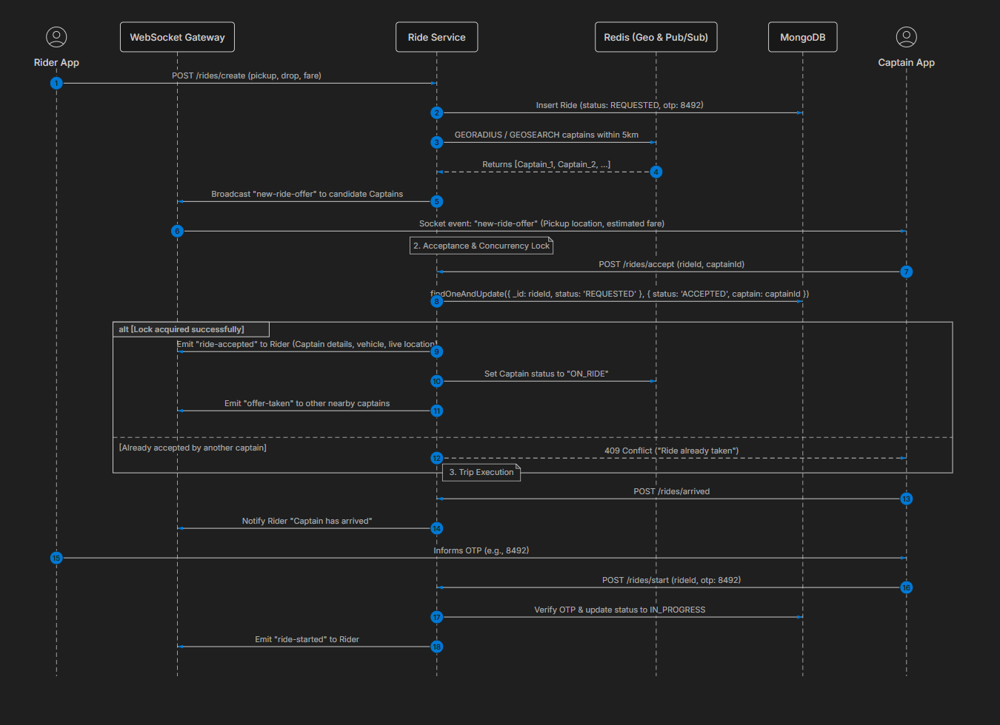
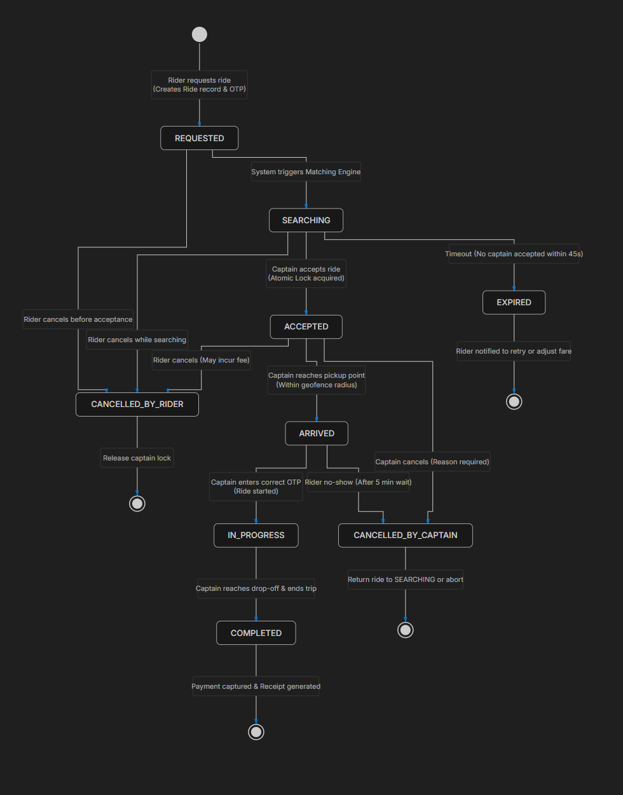
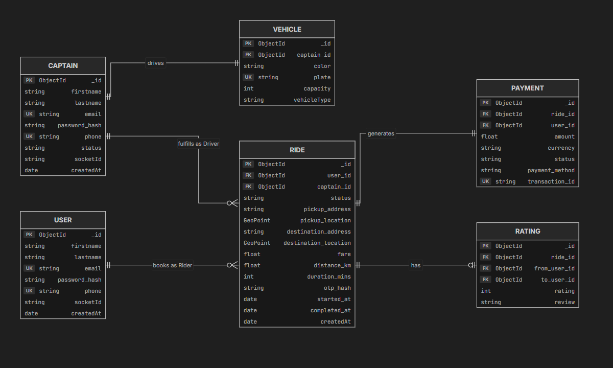

# 🚗 RideFlow — Real-Time Ride-Sharing & Distributed Dispatch Platform

[](https://nodejs.org/)
[](https://expressjs.com/)
[](https://react.dev/)
[](https://socket.io/)
[](https://www.mongodb.com/)
[](https://www.openstreetmap.org/)
[](https://tailwindcss.com/)
[](LICENSE)

An enterprise-grade, distributed ride-hailing and matching engine architecture engineered with **Node.js, Express, Socket.IO, MongoDB (2dsphere geospatial indexing), and React (Vite)**. Built to demonstrate high-concurrency dispatching, race-condition mitigation, state machine lifecycle management, and real-time bidirectional geospatial tracking.

---

## 📑 Table of Contents

- [Architectural Overview](#-architectural-overview)
- [System Design Diagrams](#-system-design-diagrams)
  - [1. End-to-End Request Flow](#1-end-to-end-request-flow)
  - [2. Ride Lifecycle Finite State Machine (FSM)](#2-ride-lifecycle-finite-state-machine-fsm)
  - [3. Domain Data Model & Geospatial Schema](#3-domain-data-model--geospatial-schema)
- [Core Engineering Highlights](#-core-engineering-highlights)
  - [Cascading Dispatch Engine](#1-cascading-dispatch-matching-engine)
  - [Concurrency & Atomic Locks](#2-concurrency-control--race-condition-elimination)
  - [Cryptographic 4-Digit OTP Handshake](#3-cryptographic-4-digit-otp-boarding-handshake)
  - [100% Free Mapping Stack (Zero API Costs)](#4-100-free-open-source-mapping-stack)
  - [Dual Session & Auth Architecture](#5-dual-role-session-isolation)
- [Interactive Web Client](#-interactive-web-client-react--tailwind-css)
- [Real-Time Socket.IO Protocol](#-real-time-socketio-protocol)
- [REST API Reference](#-rest-api-reference)
- [Project Directory Structure](#-project-directory-structure)
- [Getting Started](#-getting-started)
- [Roadmap & Distributed Scalability](#-roadmap--distributed-scalability)
- [Author & Acknowledgments](#-author--acknowledgments)

---

## 🏛️ Architectural Overview

```
                                      +---------------------------------------------+
                                      |           Client Layer (React / Vite)       |
                                      +---------------------------------------------+
                                        /                                         \
                    HTTP (REST)        /                                           \        WebSocket (WSS)
                                      v                                             v
                      +-------------------------------+             +-------------------------------+
                      |   Express 5.x API Gateway     |             |    Socket.IO Event Gateway    |
                      +-------------------------------+             +-------------------------------+
                                      |                                             |
             +------------------------+------------------------+                    |
             |                        |                        |                    |
             v                        v                        v                    v
  +--------------------+   +--------------------+   +--------------------+  +--------------------+
  |  Auth & Blacklist  |   | Maps & Routing     |   | Dynamic Fare       |  | Cascading Matching |
  |  (JWT + TTL Index) |   | (OSM + Haversine)  |   | Calculation Matrix |  | Dispatch Engine    |
  +--------------------+   +--------------------+   +--------------------+  +--------------------+
             |                        |                        |                    |
             +------------------------+------------------------+                    |
                                      |                                             |
                                      v                                             v
                      +-----------------------------------------------------------------------------+
                      |                      MongoDB Persistence Layer                              |
                      |            (Users, Captains 2dsphere GeoJSON, Rides, Blacklist)             |
                      +-----------------------------------------------------------------------------+
```

RideFlow decouples synchronous request handling (fare calculation, authentication, profile management) from asynchronous, time-sensitive event pipelines (driver discovery, 15-second cascading offer dispatches, telemetry ingestion).

---

## 📊 System Design Diagrams

### 1. End-to-End Request Flow
The complete flow from rider fare estimation to cascading dispatch, driver acceptance, OTP verification, and trip completion:



---

### 2. Ride Lifecycle Finite State Machine (FSM)
Guarantees strict linear state progression with idempotency and access control checks at every stage:



```
[REQUESTED] ─── (Nearest drivers identified via 2dsphere spatial index)
     │
     ▼
[ACCEPTED] ──── (Captain accepts 15s offer via atomic findOneAndUpdate)
     │
     ▼
[ARRIVED] ───── (Captain reaches pickup GPS coordinates)
     │
     ▼
[IN_PROGRESS] ─ (Captain inputs & verifies Rider's 4-digit OTP)
     │
     ▼
[COMPLETED] ─── (Captain concludes ride; status resets to 'active')
```

---

### 3. Domain Data Model & Geospatial Schema
Complete entity-relationship diagram with GeoJSON `Point` coordinates and composite indexing:



---

## ⚙️ Core Engineering Highlights

### 1. Cascading Dispatch Matching Engine
Instead of broadcasting ride requests indiscriminately to every driver in a city (which causes high server load and driver frustration), RideFlow uses an intelligent, sequential **cascading dispatch engine**:
- **Proximity Filtering**: Queries MongoDB using `$near` with `$maxDistance: 5000` (5km) and matching `vehicleType`.
- **Sequential Offer Windows**: Offers the trip to the closest candidate driver with an active **15-second timeout**.
- **Deterministic Fallback**: If the driver ignores the request or the 15-second window elapses, the engine gracefully cancels that offer and cascades immediately to the next closest candidate driver.
- **Fast Decline**: If a driver clicks **Decline**, the timer is cleared instantly and the offer is dispatched to candidate $i+1$ without waiting for the timeout.

### 2. Concurrency Control & Race Condition Elimination
In high-throughput ride-sharing systems, two drivers might accept the same ride within milliseconds:
```javascript
// Atomic acquisition via MongoDB findOneAndUpdate
const ride = await rideModel.findOneAndUpdate(
    { _id: rideId, status: 'REQUESTED' },
    { status: 'ACCEPTED', captain: captainId },
    { returnDocument: 'after' }
).select('+otp').populate('user', '-password').populate('captain', '-password');

if (!ride) {
    throw new Error('Ride not found or already accepted by another captain');
}
```
> [!IMPORTANT]
> The atomic query matches `status: 'REQUESTED'`. The very first driver to execute the query changes the status to `'ACCEPTED'`. Any subsequent concurrent requests receive `null` and are rejected with an explicit conflict exception.

### 3. Cryptographic 4-Digit OTP Boarding Handshake
- **Cryptographic Generation**: A random 4-digit code is generated via `crypto.randomInt(1000, 10000)`.
- **Zero Knowledge on Driver Side**: The `otp` field is configured with `select: false` in Mongoose. When the ride offer is sent to the driver, `otp` is stripped.
- **Rider Verification**: The 4-digit OTP is displayed on the Rider's console. The trip **cannot** transition to `IN_PROGRESS` until the passenger boards and the driver enters the exact code.

### 4. 100% Free Open-Source Mapping Stack
Zero reliance on paid Google Maps or Mapbox API keys. The entire mapping, geocoding, and distance matrix operates with free, open-source technology:
- **Interactive Map Canvas**: Powered by **Leaflet** with standard **OpenStreetMap (OSM)** raster tiles (`https://{s}.tile.openstreetmap.org/{z}/{x}/{y}.png`).
- **Hardware-Accelerated Dark Theme**: Standard OSM tiles are styled dynamically via CSS filter inversion (`invert(100%) hue-rotate(180deg) brightness(85%) contrast(90%)`), yielding a high-contrast luxury obsidian interface without API limits.
- **In-Memory Haversine Engine**: Distance and duration are computed via spherical geometry with a calibrated **$1.25\times$ urban road tortuosity factor** and city speed profiles, providing instant, cost-free ETAs. (An optional Google Maps adapter is also supported if an API key is provided).

### 5. Dual-Role Session Isolation
To enable running both the **Rider Console** and **Captain Console** simultaneously on the same workstation:
- **Prioritized Headers**: Authentication middleware inspects `Authorization: Bearer <token>` before checking fallback cookies.
- **Distinct Cookies**: Rider sessions write `rider_token`, while Captain sessions write `captain_token`.
- **Token Blacklisting**: Logout adds the JWT signature into a MongoDB blacklist collection with a **TTL (Time-To-Live) index** matching the token expiration, preventing replay attacks.

---

## 💻 Interactive Web Client (React + Tailwind CSS)

Built with React 18, Vite, and Tailwind CSS, featuring an **Obsidian, Electric Emerald, and Cyber Amber** luxury palette.

```
┌──────────────────────────────────────┬──────────────────────────────────────┐
│         PASSENGER / RIDER            │            DRIVER / CAPTAIN          │
├──────────────────────────────────────┼──────────────────────────────────────┤
│ • Interactive Route & Address Input  │ • Online / Offline Toggle            │
│ • Dynamic Fares (Car / Auto / Moto)  │ • Live GPS Coordinate Broadcaster    │
│ • Cascading Search Radar             │ • 15-Second Cascading Offer Modal    │
│ • 4-Digit Boarding OTP Passcard      │ • 4-Digit Auto-Focus OTP Input Boxes │
│ • Live Driver Marker & Details Card  │ • Simulated Live Drive & Navigation  │
│ • Digital Fare Settlement Receipt    │ • Trip Complete & Payout Summary     │
└──────────────────────────────────────┴──────────────────────────────────────┘
```

---

## 📡 Real-Time Socket.IO Protocol

Clients connect to `ws://localhost:4000` (or `http://localhost:4000`).

### 1. Room Registration
Immediately upon connection, clients register their role and user ID:
```json
// Rider
socket.emit('join', { "userId": "<USER_ID>", "userType": "user" })

// Captain
socket.emit('join', { "userId": "<CAPTAIN_ID>", "userType": "captain" })
```

### 2. Real-Time Event Matrix

| Event Name | Direction | Payload | Description |
|---|---|---|---|
| `new-ride-offer` | Server $\rightarrow$ Captain | `{ rideId, pickup, destination, fare, distance, duration, timeoutSeconds: 15 }` | Dispatched to candidate driver |
| `offer-expired` | Server $\rightarrow$ Captain | `{ rideId }` | 15s offer window expired |
| `offer-cancelled` | Server $\rightarrow$ Captain | `{ rideId }` | Driver declined offer |
| `ride-confirmed` | Server $\rightarrow$ Captain | `{ message, ride }` | Driver successfully acquired trip |
| `ride-accepted` | Server $\rightarrow$ Rider | `{ message, ride, captain }` | Captain assigned to passenger |
| `ride-started` | Server $\rightarrow$ Rider | `{ message, ride }` | Driver verified OTP; trip started |
| `ride-ended` | Server $\rightarrow$ Rider | `{ message, ride }` | Trip completed; payment settled |
| `no-captains-found`| Server $\rightarrow$ Rider | `{ rideId, message }` | All nearby drivers busy/declined |

---

## 🚀 REST API Reference

### 1. Authentication Endpoints

| Method | Endpoint | Access | Description |
|---|---|---|---|
| `POST` | `/users/register` | Public | Register passenger account |
| `POST` | `/users/login` | Public | Authenticate passenger (returns JWT) |
| `GET` | `/users/profile` | Rider Auth | Get authenticated passenger profile |
| `GET` | `/users/logout` | Rider Auth | Blacklist token & revoke session |
| `POST` | `/captains/register` | Public | Register driver with vehicle profile |
| `POST` | `/captains/login` | Public | Authenticate driver (returns JWT) |
| `GET` | `/captains/profile` | Captain Auth | Get authenticated driver profile |
| `GET` | `/captains/logout` | Captain Auth | Blacklist token & revoke session |

### 2. Driver Location & Availability

#### `PATCH /captains/location` (Captain Auth)
Updates driver's GPS location into MongoDB's `2dsphere` spatial index:
```json
{
  "latitude": 28.6129,
  "longitude": 77.2295
}
```

#### `PATCH /captains/status` (Captain Auth)
```json
{
  "status": "active" // "active" | "inactive"
}
```

#### `GET /captains/nearby` (Public / Query)
```
GET /captains/nearby?latitude=28.6315&longitude=77.2167&radius=5000&vehicleType=car
```

### 3. Fares & Ride Lifecycle

#### `GET /rides/get-fare` (Rider Auth)
```
GET /rides/get-fare?pickup=Connaught Place, New Delhi&destination=India Gate, New Delhi
```
**Sample Response:**
```json
{
  "fare": {
    "car": 142,
    "auto": 89,
    "moto": 58
  },
  "distance": { "text": "4.2 km", "value": 4200 },
  "duration": { "text": "11 mins", "value": 660 }
}
```

#### `POST /rides/create` (Rider Auth)
```json
{
  "pickup": "Connaught Place, New Delhi",
  "destination": "India Gate, New Delhi",
  "vehicleType": "car"
}
```

#### `POST /rides/confirm` (Captain Auth)
```json
{ "rideId": "6ae0b411..." }
```

#### `POST /rides/reject` (Captain Auth)
```json
{ "rideId": "6ae0b411..." }
```

#### `POST /rides/start-ride` (Captain Auth)
```json
{
  "rideId": "6ae0b411...",
  "otp": "4821"
}
```

#### `POST /rides/end-ride` (Captain Auth)
```json
{ "rideId": "6ae0b411..." }
```

---

## 📁 Project Directory Structure

```
Uber/
├── Backend/
│   ├── controllers/         # Request handling & HTTP responses
│   │   ├── captain.controller.js
│   │   ├── map.controller.js
│   │   ├── ride.controller.js
│   │   └── user.controller.js
│   ├── db/                  # MongoDB Mongoose connection
│   │   └── db.js
│   ├── middlewares/         # JWT verification & token blacklist checks
│   │   └── auth.middleware.js
│   ├── models/              # Mongoose schemas & indexes
│   │   ├── blacklistToken.model.js
│   │   ├── captain.model.js (2dsphere index)
│   │   ├── ride.model.js (FSM state enum)
│   │   └── user.model.js
│   ├── routes/              # Express route declarations
│   ├── services/            # Domain logic & algorithms
│   │   ├── captain.service.js
│   │   ├── dispatch.service.js (Cascading matching engine)
│   │   ├── maps.service.js (OSM / Haversine / Google)
│   │   ├── ride.service.js (Fare calculation & OTP)
│   │   └── user.service.js
│   ├── app.js               # Express application configuration
│   ├── server.js            # HTTP & Socket.IO server bootstrap
│   ├── socket.js            # WebSocket connection gateway & rooms
│   └── package.json
│
├── Frontend/
│   ├── src/
│   │   ├── components/
│   │   │   ├── AuthModal.jsx    # Rider & Driver login/signup modals
│   │   │   ├── DriverPanel.jsx  # Driver telemetry, offers & OTP input
│   │   │   ├── Map.jsx          # Leaflet + OSM dark mode map canvas
│   │   │   ├── Navbar.jsx       # Header & quick profile switches
│   │   │   └── RiderPanel.jsx   # Booking, fare cards & OTP display
│   │   ├── context/
│   │   │   ├── AuthContext.jsx  # Persistent authentication state
│   │   │   └── SocketContext.jsx# Live Socket.IO client provider
│   │   ├── App.jsx              # Dual split-screen console layout
│   │   ├── index.css            # Custom CSS & tile filter overrides
│   │   └── main.jsx
│   ├── index.html
│   ├── tailwind.config.js
│   ├── vite.config.js
│   └── package.json
│
├── CompleteRequestFlow.png
├── DomainDataModel.png
├── RideLifecycleFiniteStateMachine.png
├── DriverAcceptingRequestArchitectureHLD.excalidraw
└── README.md
```

---

## 🛠️ Getting Started

### Prerequisites
- [Node.js](https://nodejs.org/) (v18.0.0 or higher)
- [MongoDB](https://www.mongodb.com/) (Local instance running on `mongodb://127.0.0.1:27017` or Atlas URI)
- [Git](https://git-scm.com/)

---

### Step 1: Clone the Repository
```bash
git clone https://github.com/Rajtiwari0202/ride_sharing_platform.git
cd ride_sharing_platform
```

---

### Step 2: Configure & Start the Backend
```bash
cd Backend
npm install
```

Create a `.env` file in the `Backend/` directory:
```env
PORT=4000
MONGO_URI=mongodb://127.0.0.1:27017/uber
JWT_SECRET=production_ultra_secret_jwt_key_98765
GOOGLE_MAPS_API= # Optional: leave blank to use free OpenStreetMap + Haversine
```

Start the backend server in development mode:
```bash
npm run dev
```
> [!NOTE]
> The backend server starts on `http://localhost:4000` with MongoDB connected and Socket.IO listening for real-time events.

---

### Step 3: Configure & Start the Frontend
In a new terminal window:
```bash
cd ../Frontend
npm install
npm run dev
```
Open your browser and navigate to **`http://localhost:5173`**.

---

### Step 4: Quick Demo Walkthrough

1. **Rider Login**: Click **Sign In** on the top navigation bar $\rightarrow$ select **Rider** $\rightarrow$ click **Quick Demo Rider** (`john@example.com` / `password123`).
2. **Captain Login**: Click **Sign In** $\rightarrow$ select **Captain** $\rightarrow$ click **Quick Demo Captain** (`alex.captain@example.com` / `password123`).
3. **Toggle Online**: In the right-hand **Captain Console**, ensure status is set to **Online** (green beacon).
4. **Calculate Fares**: In the left-hand **Rider Console**, review pickup and destination locations, then click **Calculate Fares**.
5. **Request Ride**: Select **Car**, **Auto**, or **Moto**, and click **Confirm & Request**.
6. **Accept Cascading Offer**: An alert modal with a 15-second countdown timer will pop up on the Captain Console. Click **Accept Offer**.
7. **Verify OTP**: The Rider Console will display a 4-digit passcode (e.g., `4 8 2 1`). Enter this code into the Captain Console's auto-advancing OTP boxes and click **Verify & Start Trip**.
8. **Simulate Drive & Complete**: Click **Simulate GPS Drive** to watch the vehicle move across the Leaflet map in real time, then click **End Trip & Collect Fare**.

---

## 🔮 Roadmap & Distributed Scalability

- [ ] **Redis Pub/Sub Socket Adapter**: Horizontally scale Socket.IO across multiple Node.js instances behind an Nginx load balancer.
- [ ] **Redis Geospatial Indexing**: Shift transient driver GPS coordinates to Redis `GEOADD` / `GEORADIUS` for sub-millisecond proximity queries, writing to MongoDB only on trip events.
- [ ] **Redlock Distributed Locking**: Replace MongoDB atomic queries with distributed locks in multi-region clusters.
- [ ] **Trip Telemetry Playback**: Apache Kafka streaming for real-time driver tracking, analytics, and trip route reconstruction.

---

## 👨‍💻 Author & Acknowledgments

- **Raj Tiwari** — [@Rajtiwari0202](https://github.com/Rajtiwari0202)
- Architecture inspired by Uber and Lyft engineering whitepapers on geospatial matching, state machines, and distributed dispatching.

---

<p align="center">
  <b>⭐ If you find this project informative or helpful, consider starring the repository! ⭐</b>
</p>
